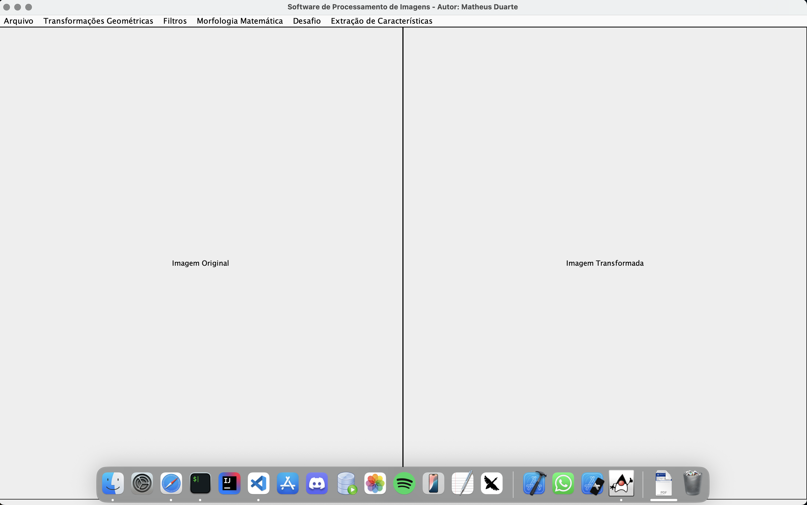
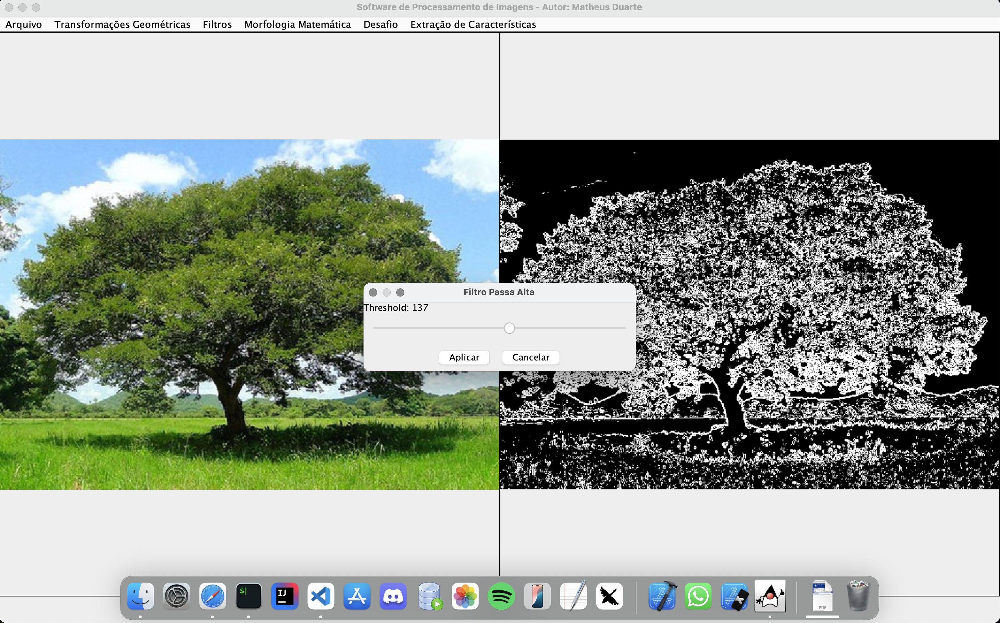
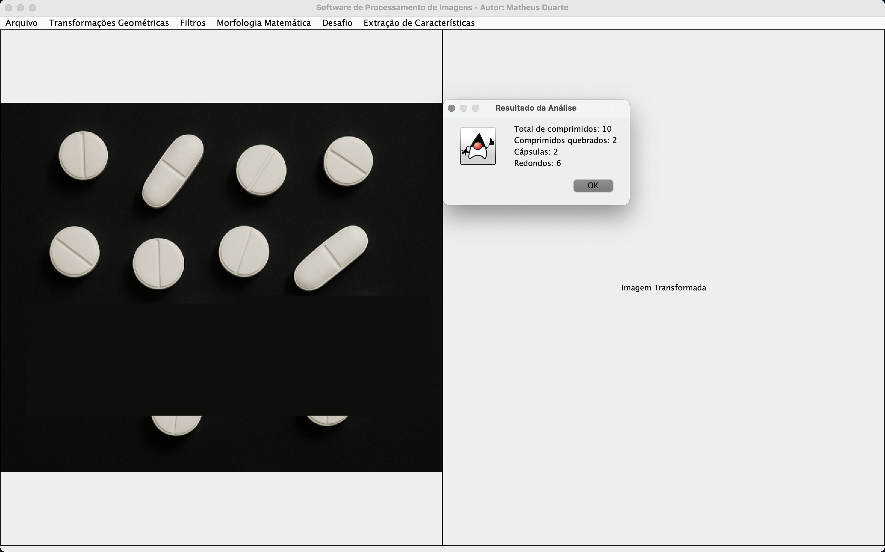

# 🧠 Projeto CorelDraw PDI

Este projeto foi desenvolvido como parte da disciplina **Processamento Digital de Imagens (PDI)** no curso de **Ciência da Computação** da **Universidade Feevale**, sob orientação da professora **Marta Bez**. Ele consistiu na criação de um software educacional, com interface gráfica em Java, que simula operações e ferramentas de edição e análise de imagens semelhantes às do CorelDraw, com foco em PDI.

Este projeto obteve **nota máxima (10)** e representa um marco importante na minha formação, consolidando diversos conhecimentos de computação gráfica, morfologia matemática, extração de características e manipulação de imagens.

---

## 📚 O que eu aprendi com este projeto

Durante o desenvolvimento deste sistema, aprofundei meus conhecimentos nos seguintes tópicos:

### 🖼️ Representação e manipulação de imagens
- Leitura, exibição e modificação de imagens usando matrizes de pixels;
- Conversão entre representações `BufferedImage` e estruturas personalizadas (ex: `ImageMatrix`);

### 🧪 Filtros e transformações
- Implementação de filtros passa-alta e passa-baixa;
- Ajustes de brilho e contraste;
- Operações morfológicas como erosão, dilatação, abertura e fechamento;
- Transformações geométricas como rotação, escala e translação.

### 🔍 Extração de características
- Implementação do algoritmo **Flood Fill** para segmentação de regiões conectadas;
- Cálculo de **área**, **perímetro**, **bounding box** e **circularidade** dos objetos;
- Classificação de formas: identificação de **cápsulas**, **comprimidos redondos** e **comprimidos quebrados**, com base em medidas morfométricas e limiares visuais definidos empiricamente.

### 🧮 Thinning (Afinamento)
- Estudo teórico dos algoritmos de afinamento: **Stentiford**, **Zhang-Suen** e **Holt**;
- Entendimento do conceito de esqueletonização e sua aplicação em reconhecimento de padrões e biometria.

---

## 🧪 Funcionalidades implementadas

- 📂 Carregamento e salvamento de imagens;
- 🎨 Aplicação de filtros diversos (tons de cinza, brilho/contraste, convoluções);
- 🔍 Transformações geométricas com sliders interativos;
- 🧬 Morfologia matemática (Erosão, Dilatação, Abertura, Fechamento);
- 🧠 **Menu Desafio** com detecção e classificação automática de comprimidos em esteira (projeto final);
- 📏 Extração de características como área, perímetro e circularidade de objetos na imagem.

---

## 💡 Desafio Final

Como projeto final da disciplina, desenvolvi uma funcionalidade capaz de:
- Detectar automaticamente todos os comprimidos presentes na imagem;
- Identificar quais estão quebrados (não aproveitáveis);
- Classificar os objetos como **cápsulas** ou **comprimidos redondos** com base em sua forma e proporção de bounding box.

Esse desafio simulava um caso real de controle de qualidade em uma esteira de produção industrial. A solução foi construída com base nos conceitos vistos em aula e conteúdos complementares fornecidos pela professora Marta, como:
- Morfometria;
- Análise de formas e conectividade;
- Circularidade e proporções geométricas;
- Segmentação por crescimento de regiões com algoritmo Flood Fill.

---

## 🛠️ Tecnologias e ferramentas usadas

- ☕ Java (JDK 17)
- 🧩 Swing para construção da interface gráfica
- 🖼️ Manipulação direta de `BufferedImage`
- 📐 Algoritmos de geometria computacional
- 🧪 Estruturas de dados como pilhas e filas para flood fill

---

## 🧑‍🏫 Agradecimentos

Este projeto foi orientado pela professora **Marta Bez**, que forneceu não apenas o embasamento teórico necessário, mas também desafios práticos que enriqueceram minha aprendizagem e me incentivaram a buscar soluções robustas e eficientes.

---

## 📸 Screenshots

### 🖥️ Interface Principal

### 🎨 Filtros Aplicados

### 💊 Análise de Comprimidos

---

## 📁 Organização do código

O código está organizado em pacotes como:
- `br.com.pdi.view` → Interface gráfica
- `br.com.pdi.filters` → Filtros e ajustes
- `br.com.pdi.morfologia` → Morfologia matemática
- `br.com.pdi.analysis` → Análise e extração de características
- `br.com.pdi.model` → Estruturas de imagem (`ImageMatrix`)

---

## 📌 Observações finais

Este projeto foi um divisor de águas na minha jornada como estudante de computação. A experiência prática de aplicar técnicas de PDI em um sistema funcional me proporcionou um aprendizado profundo sobre algoritmos, estruturas de dados, e o poder da matemática aplicada à computação gráfica.

---

